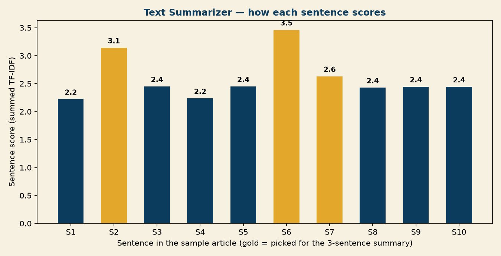
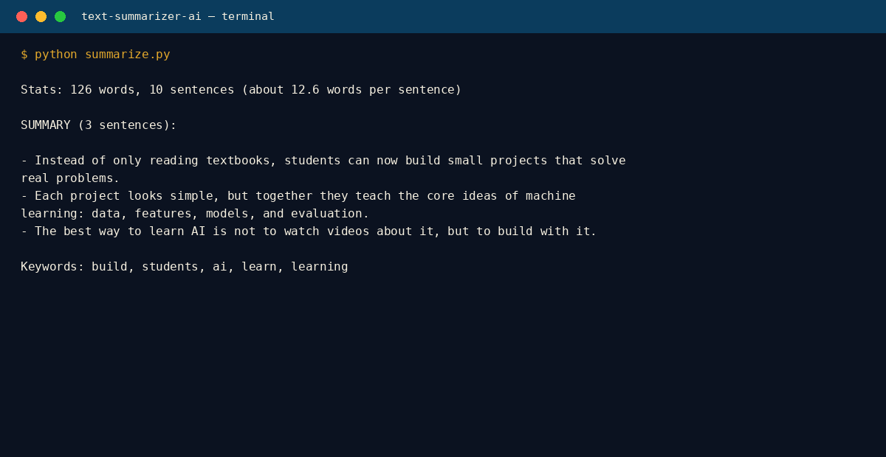
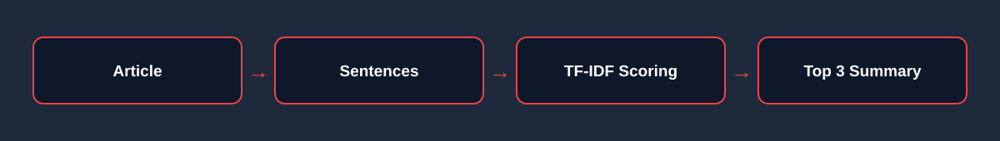

# Text Summarizer AI

   [](LICENSE) 

An **extractive summarizer**: paste a long article and receive its most important sentences, verbatim and in reading order. No neural network, no API key — just well-applied TF-IDF.

## Who this helps

- **Students and researchers** — paste a long article and get its three most important sentences verbatim, useful for a first pass over reading material.
- **NLP learners** — a working example of extractive summarization with TF-IDF sentence scoring, with no API key and no neural network to set up.
- **Readers short on time** — the stats line (word count, sentence count) plus the summary gives a quick, honest preview before committing to the full text.
- **Teachers** — the sentence-score chart shows exactly which sentences the algorithm picked and why, making the method easy to demonstrate.

## Sample output

Input: a 10-sentence article on learning AI. Output:

> - Instead of only reading textbooks, students can now build small projects that solve real problems.
> - Each project looks simple, but together they teach the core ideas of machine learning: data, features, models, and evaluation.
> - The best way to learn AI is not to watch videos about it, but to build with it.
>
> Keywords: build, students, ai, learn, learning

## Results



*Generated by `generate_charts.py`, which scores the sample article (126 words, 10 sentences) with the same TF-IDF logic as `summarize.py`. The three gold bars are the summary sentences: sentence 6 scores highest (3.46), then sentence 2 (3.14) and sentence 7 (2.63). Every run also prints a stats line — word count, sentence count and average sentence length.*

## Demo



*Real run of `python summarize.py` — the built-in 10-sentence article summarised to its 3 most important sentences, with stats and keywords.*

## How it works



Sentences are scored by the summed TF-IDF weight of their words: sentences dense in rare, meaningful terms outrank filler. The top three are then restored to their original order so the summary reads naturally. During development, three scoring variants were benchmarked; a length-penalised variant consistently selected the weakest sentences, so the straightforward total score — verified against the sample — is what ships.

## Download & run (2 minutes)

**Step 1 — Download the code**

```bash
git clone https://github.com/mehtadeven/text-summarizer-ai.git
cd text-summarizer-ai
```

No Git? On the GitHub page for this repo, click the green **Code** button, choose **Download ZIP**, unzip it, and open that folder in a terminal.

**Step 2 — Install what it needs** (Python 3.10 or newer)

```bash
pip install -r requirements.txt
```

**Step 3 — Run it**

```bash
python summarize.py                      # summarise the built-in sample article
python summarize.py my.txt               # summarise any text file of your own
python summarize.py my.txt --sentences 5 # choose a longer summary (default: 3)
```

**Step 4 — What you should see**

You should see a stats line, a 3-sentence summary and a Keywords line — exactly like the demo image above.

## Tests

```bash
pip install pytest
python -m pytest tests/
```

## What this project demonstrates

- Extractive vs abstractive summarization
- TF-IDF as a reusable relevance signal (search, recommenders, chatbots)
- Empirical scoring choices: variants tested, not guessed

## Roadmap

- TextRank (graph-based) scoring comparison
- Paste-and-summarise web page

## Need help?

- **`pip` not found?** Use `python -m pip install -r requirements.txt` instead — it does the same thing.
- **Wrong folder error (file not found)?** Check your terminal is inside the repo folder — the prompt should end with the repo name, and `ls` (Mac/Linux) or `dir` (Windows) should list `README.md`.
- **Still stuck?** Open an Issue on this repo on GitHub with the command you ran and the full error message — that is the fastest way to get help.

## Contributing

Contributions are welcome — see [CONTRIBUTING.md](CONTRIBUTING.md) for setup, how to run the tests, and how to suggest a change.

---

**Author:** [Mehta Deven](https://github.com/mehtadeven) — IT student at SAL College of Engineering, Ahmedabad, building a public portfolio in Python, Machine Learning and AI.
**Portfolio:** [mehtadeven.github.io/portfolio](https://mehtadeven.github.io/portfolio/)

## Licence

MIT — see [LICENSE](LICENSE) for the full text.
